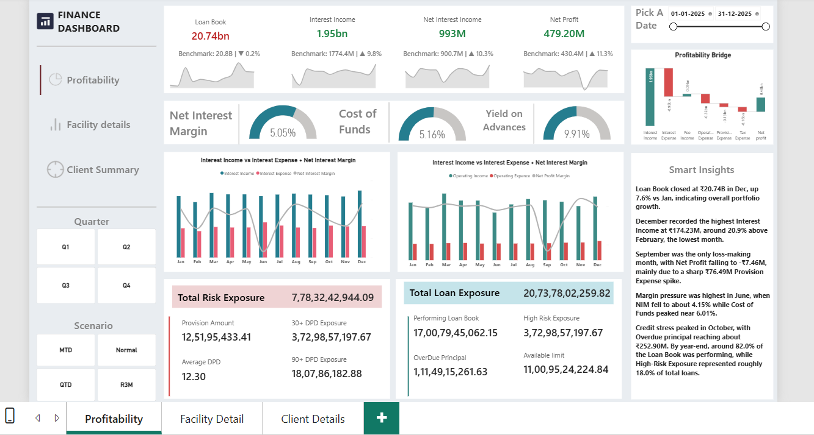
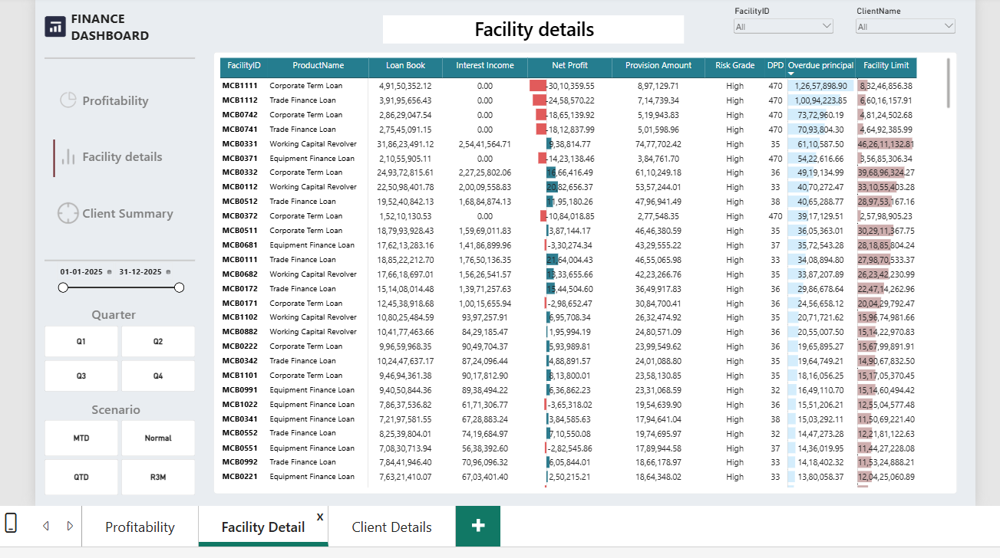
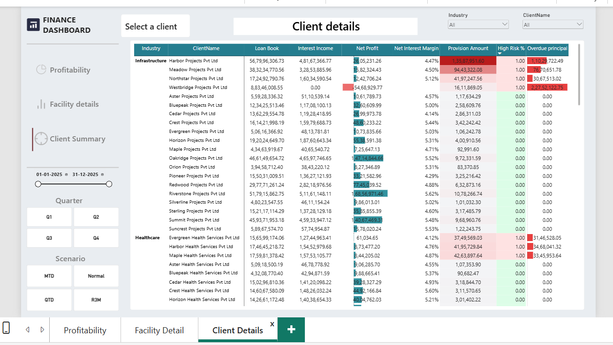

# Finance Performance & Risk Reporting Dashboard

## 📊 Project Overview

This project is a Finance Performance and Risk Reporting Dashboard developed using **Microsoft Excel and Power BI**.

The dashboard provides a consolidated view of corporate banking performance across profitability, client portfolio, facility-level exposure, credit risk, overdue principal, and key financial KPIs.

The project is designed to support management reporting and business decision-making by converting monthly banking data into interactive and easy-to-monitor reports.

---

## 🎯 Business Objective

The objective of this project is to help management:

- Monitor overall loan portfolio performance
- Track interest income and net profit
- Analyze profitability and margin performance
- Identify high-risk loan exposure
- Monitor overdue principal and Days Past Due (DPD)
- Analyze client-level financial performance
- Analyze facility-level exposure and risk
- Compare performance across months and quarters
- Support management-level financial reporting

---

## 🛠️ Tools & Technologies

- Microsoft Excel
- Power BI
- Power Query
- DAX
- Data Modeling
- Data Visualization
- KPI Reporting
- Financial & Risk Reporting

---

## 📁 Dataset Structure

The source Excel workbook contains a fact table and dimension tables.

### Fact Table

`Fact_Banking_Monthly`

Contains monthly facility-level banking data including:

- Opening Principal
- Disbursement Amount
- Principal Repayment
- Closing Principal
- Average Principal
- Average Earning Assets
- Average Funding Balance
- Facility Limit
- Interest Income
- Interest Expense
- Fee Income
- Operating Expense
- Provision Expense
- Tax Expense
- Overdue Principal
- Days Past Due (DPD)
- Risk Grade

### Dimension Tables

#### Dim_Client
Contains:

- Client ID
- Client Name
- Industry
- Client Segment

#### Dim_Product
Contains:

- Product ID
- Product Name
- Product Category

#### Dim_Branch
Contains:

- Branch ID
- Branch Name
- City
- Region

---

## 📌 Key KPIs

The dashboard tracks important financial and risk KPIs such as:

| KPI | Value |
|---|---:|
| Loan Book | ₹20.74B |
| Interest Income | ₹1.95B |
| Net Interest Income | ₹993M |
| Net Profit | ₹479.20M |
| Net Interest Margin | 5.05% |
| Cost of Funds | 5.16% |
| Yield on Advances | 9.91% |
| Total Risk Exposure | ₹7.78B |
| Total Loan Exposure | ₹20.74B |
| Overdue Principal | ₹1.11B |
| Average DPD | 12.30 |
| High-Risk Exposure | ₹3.73B |

> KPI values shown above represent the reporting period used in the dashboard.

---

## 📊 Dashboard Pages

### 1. Profitability

The Profitability dashboard provides an executive-level view of financial performance.

It includes:

- Loan Book
- Interest Income
- Net Interest Income
- Net Profit
- Net Interest Margin
- Cost of Funds
- Yield on Advances
- Profitability Bridge
- Monthly income and expense trends
- Total Risk Exposure
- Total Loan Exposure
- Performing Loan Book
- Overdue Principal
- High-Risk Exposure
- Smart Business Insights

---

### 2. Facility Details

The Facility Details page provides facility-level reporting.

Key fields include:

- Facility ID
- Product Name
- Loan Book
- Interest Income
- Net Profit
- Provision Amount
- Risk Grade
- Days Past Due
- Overdue Principal
- Facility Limit

Conditional formatting is used to highlight risk and financial exposure.

---

### 3. Client Details

The Client Details page provides client-level reporting.

It includes:

- Industry
- Client Name
- Loan Book
- Interest Income
- Net Profit
- Net Interest Margin
- Provision Amount
- High Risk %
- Overdue Principal

Users can filter the report by:

- Industry
- Client
- Date
- Quarter
- Reporting Scenario

---

## 🔎 Key Business Insights

Based on the dashboard analysis:

### Portfolio Growth
The loan book closed at approximately **₹20.74B in December**, showing portfolio growth during the reporting period.

### Interest Income
December recorded approximately **₹174.23M in Interest Income**, making it one of the key contributors to overall portfolio profitability.

### Profitability
The overall reporting period generated approximately **₹479.20M in Net Profit**.

### Credit Risk
Total risk exposure was approximately **₹7.78B**, with high-risk exposure of approximately **₹3.73B**.

### Overdue Exposure
Overdue principal was approximately **₹1.11B**, indicating an important area for credit monitoring.

### DPD Monitoring
Average Days Past Due was approximately **12.30 days**, providing an additional indicator of portfolio credit quality.

### Margin Pressure
Net Interest Margin was approximately **5.05%**, while Cost of Funds was approximately **5.16%**, highlighting the importance of monitoring funding costs and lending yields.

---

## 🎛️ Interactive Filters

The dashboard provides interactive filtering capabilities including:

- Date Range
- Quarter
- Scenario
- Industry
- Client
- Facility
- Product

These filters allow users to perform focused management reporting and drill-down analysis.

---

## 📸 Dashboard Preview

### Profitability Dashboard



### Facility Details



### Client Details



---

## 📂 Project Files

```text
Finance-Performance-Risk-Dashboard/
│
├── Dashboard/
│   └── Finance project.pbix
│
├── Data/
│   └── Meridian_Corporate_Bank_2025.xlsx
│
├── Screenshots/
│   ├── Finance_dashbord_profitability.png
│   ├── Finance_dashboard_facility_details.png
│   └── Finance_dashboard_client_details.png
│
└── README.md